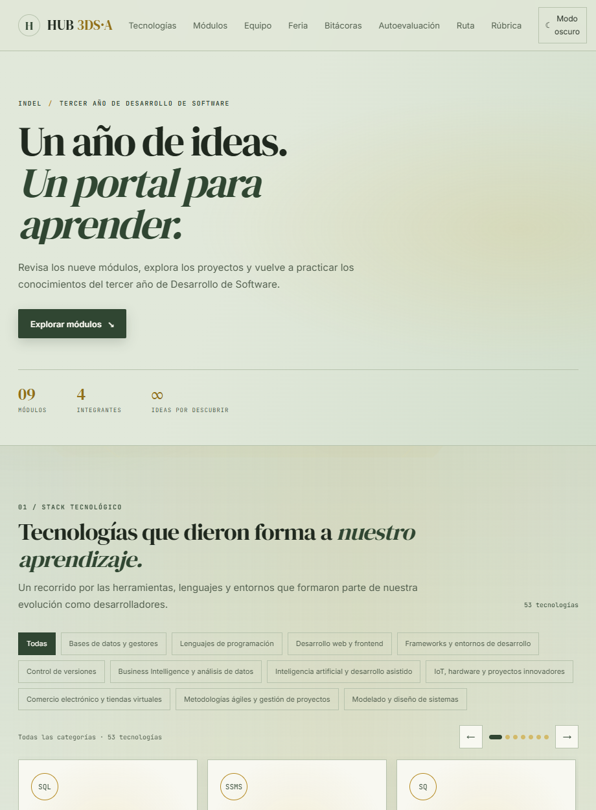

# HUB 3DS·A — Portal educativo v1.0

Portal estático de repaso para 3.º de Desarrollo de Software «A» del INDEL. Reúne nueve módulos, proyectos y evidencias del año en una experiencia hecha con HTML, CSS y JavaScript nativos.

> **Estado:** la versión v1.0 está implementada en este espacio de trabajo y cuenta con pruebas locales documentadas. Los cambios siguen sin commit ni publicación; la página de GitHub Pages respondió, pero no identifica esta versión local. Lighthouse, una prueba en teléfono físico y la autorización de la fotografía grupal siguen pendientes.

## Vista previa



## Funcionalidades

### Nivel Base

- Portada y navegación entre secciones.
- Nueve fichas construidas dinámicamente con los datos de `js/modulos.js`.
- Aprendizajes, instrumentos, programas, herramientas, recursos y evidencias por módulo.
- Galería modal con vista ampliada de imágenes y texto alternativo.
- Estructura estática compatible con GitHub Pages.

### Nivel Pro

- Búsqueda sin distinción de mayúsculas ni tildes; filtros por categoría y docente.
- Catálogo de **53 tecnologías y conocimientos en 11 categorías**, con tarjetas, filtros y carrusel.
- Progreso de revisión guardado en el navegador.
- Quiz de tres preguntas por módulo y práctica general aleatoria de 27 ítems; incluye retroalimentación, explicación y mejor puntaje con fecha.
- Modo claro/oscuro: respeta la preferencia del sistema en la primera visita y guarda los cambios manuales.
- Cuatro bitácoras y cuatro formularios de autoevaluación personal guardados solo en el navegador.
- Atajos y foco de teclado visibles, enlace para saltar al contenido, etiquetas accesibles y diseño adaptable.

El proyecto no declara funcionalidades del Nivel Épico que no estén verificadas.

## Contenido académico y docentes

Los nombres y docentes se muestran según la distribución confirmada por el equipo. No se asigna un docente por la apariencia de una evidencia.

| Código | Módulo | Docente |
|---|---|---|
| BTVDS 3.0 | Orientación al estudiante al proceso educativo | Javier Mineros |
| BTVDS 3.1 | Desarrollo de aplicaciones de software para la solución de problemas | Javier Mineros |
| BTVDS 3.2 | Mantenimiento y aseguramiento de la operación del sistema informático | Francisco Arcides Canales Sorto |
| BTVDS 3.3 | Administración de Bases de Datos | Francisco Arcides Canales Sorto y Javier Mineros |
| BTVDS 3.4 | Elaboración de documentación de sistemas informáticos | Javier Mineros |
| BTVDS 3.5 | Desarrollo de componentes para dispositivos móviles | Francisco Arcides Canales Sorto |
| BTVDS 3.6 | Conversación en inglés sobre mantenimiento de sistemas informáticos | Javier Mineros |
| BTVDS 3.7 | Puesta en marcha de la microempresa en asociatividad cooperativa | Francisco Arcides Canales Sorto |
| BTVDS 3.8 | Proyecto innovador de desarrollo de software | Javier Mineros |

El recorrido enlaza, entre otros, SQL Server y el proyecto VelvetHeel, Power BI, desarrollo de escritorio con .NET, PHP/MySQL/XAMPP, Python/SQLite, soporte técnico, inglés técnico, IoT y herramientas de IA. Los recursos de las fichas apuntan a documentación y sitios de referencia.

### Evidencias y privacidad

Las evidencias se agrupan por módulo dentro de `img/`. Las imágenes públicas de BTVDS 3.4 y 3.6 son copias que ocultan datos personales. Los originales `Informatica.png` e `Ingles.png` están excluidos por `img/.gitignore`: no deben publicarse.

`Innovador.jpeg` muestra integrantes del equipo. **Confirmar la autorización de todas las personas antes de mantener esa fotografía en una publicación pública.**

## Equipo y responsabilidades

- **Samuel Eliseo Mendoza Gonzalez** — Líder Git: repositorio, integración, Pages y etiquetas de versión.
- **Daniela Yamileth Rodriguez Zepeda** — Diseñadora UI: identidad visual y estilos.
- **Marcela Abigail Mata Escobar** — Curadora de contenido: calidad de fichas y verificación de recursos.
- **Nestor Eduardo Deodanes Martinez** — QA y accesibilidad: pruebas y revisión cruzada.

La guía para ensayar defensas individuales y el checklist de Feria están en [`docs/`](docs/).

## Estructura

```text
hub-3ds-a/
├── index.html
├── css/
│   └── styles.css
├── js/
│   ├── app.js
│   ├── modulos.js
│   └── tecnologias.js
├── img/
├── docs/
│   ├── evidencias/
│   │   └── portal-v1.0.png
│   ├── Defensa-individual.md
│   ├── Feria-checklist.md
│   └── QA-v1.0.md
└── README.md
```

- `index.html`: estructura semántica y secciones del portal.
- `css/styles.css`: paleta verde musgo y oro, temas y reglas responsive.
- `js/app.js`: renderizado, búsqueda, filtros, carrusel, tema, progreso, quizzes, galerías y autoevaluaciones.
- `js/modulos.js`: información de los nueve módulos.
- `js/tecnologias.js`: catálogo de tecnologías y conocimientos.
- `img/`: evidencias y recursos gráficos.

No se requiere framework, compilación ni instalación de dependencias. Las tipografías de Google Fonts requieren conexión; se conservan alternativas de sistema.

## Ejecutar localmente

1. Abre `hub-3ds-a` en Visual Studio Code y ejecuta `index.html` con Live Server. Como alternativa, desde la raíz del repositorio inicia un servidor:

   ```powershell
   Set-Location hub-3ds-a
   python -m http.server 8000
   ```

2. Visita `http://localhost:8000/`.

Si ejecutas el servidor desde la raíz del repositorio, abre `http://localhost:8000/hub-3ds-a/`. La página `index.html` de la raíz del repositorio dirige a esta carpeta.

## Publicación y control de versiones

- Repositorio: <https://github.com/SAM-3196324/Actividadgrupal_JavierMineros>
- GitHub Pages: <https://sam-3196324.github.io/Actividadgrupal_JavierMineros/>
- La ruta de Pages sirve `hub-3ds-a/` desde el repositorio.
- El código local mostrado como v1.0 aún no tiene commit ni etiqueta verificados. No se han creado etiquetas históricas ni se ha reescrito el historial.
- Para publicar esta revisión, primero completa las comprobaciones y autorizaciones pendientes; después revisa `git status`, crea commits descriptivos y sube los cambios a la rama configurada para Pages. Confirma la URL publicada y su contenido tras el despliegue.

Los cambios de código no aparecen en GitHub Pages hasta que se incorporan a la rama fuente y termina el despliegue. Durante esta revisión, la URL pública respondió con HTTP 200, pero su título no identificó la v1.0 local. El parámetro de versión de la hoja de estilos ayuda a evitar servir una copia antigua desde caché.

## Validación

Las pruebas locales, enlaces comprobados, resultados y pendientes están detallados en [`docs/QA-v1.0.md`](docs/QA-v1.0.md). Lighthouse y la comprobación en un teléfono físico todavía no se han realizado; no se publican puntuaciones estimadas.

## Uso de IA

La IA se utilizó como apoyo para organizar contenido, revisar redacción y programar. El equipo debe cotejar cada afirmación con sus apuntes, evidencias y la guía docente; las herramientas de IA no sustituyen esa revisión ni acreditan aportes individuales. Los datos no confirmados se mantienen como pendientes y cada integrante debe describir únicamente el trabajo que realizó y puede demostrar.
